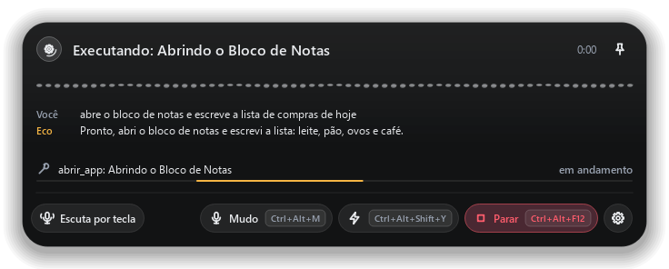
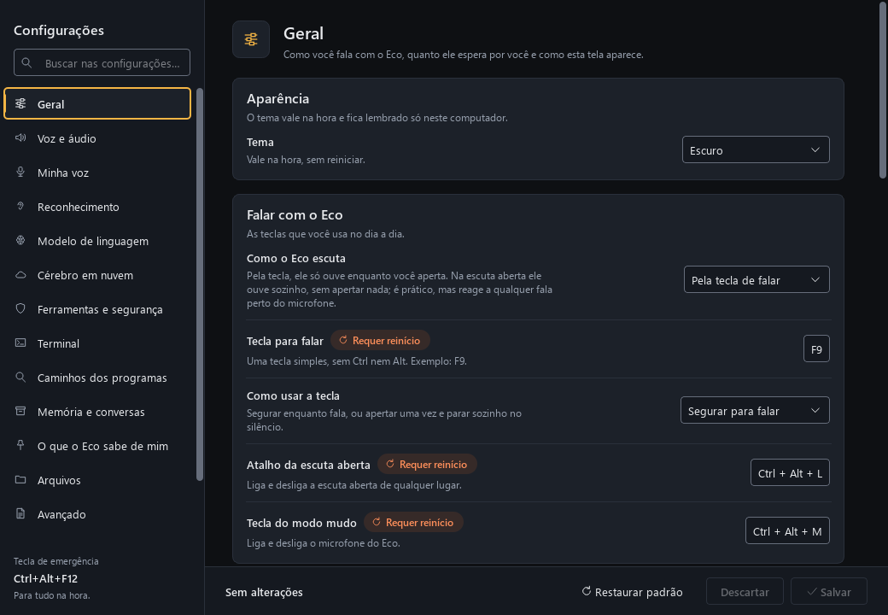
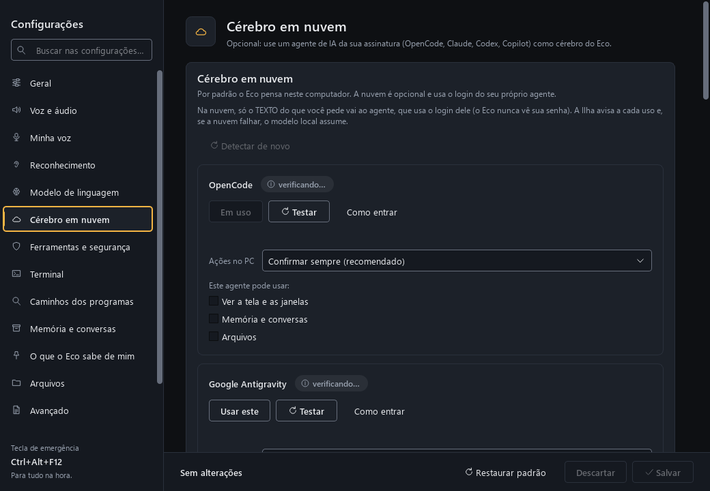
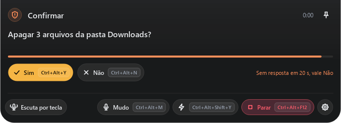
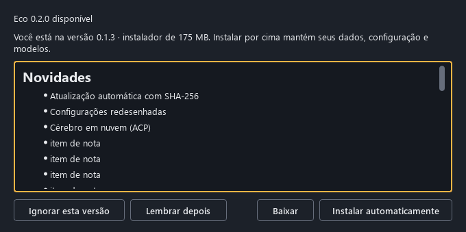

<p align="center">
  
</p>

<h1 align="center">Eco</h1>

<p align="center">
  <b>Seu assistente de voz. Local. Privado.</b><br>
  Ouve, entende, fala e controla o seu PC com Windows, em português do Brasil, com o modelo rodando na sua máquina.
</p>

<p align="center">
  <a href="https://github.com/brunocsilva41/eco/releases/latest"></a>
  <a href="LICENSE"></a>
  
  <a href="https://github.com/brunocsilva41/eco/actions/workflows/ci.yml"></a>
</p>

<p align="center">
  <a href="https://brunocsilva41.github.io/eco/"><b>Página do produto</b></a> ·
  <a href="https://github.com/brunocsilva41/eco/releases/latest"><b>Baixar para Windows</b></a> ·
  <a href="CHANGELOG.md">Novidades</a> ·
  <a href="docs/">Documentação</a>
</p>

---

## O que é o Eco

O Eco é um assistente de voz para Windows que **roda no seu computador**. Você fala; ele transcreve localmente,
pensa com um modelo de IA local (ou, se você quiser, com um agente na nuvem), responde com voz natural e pode agir
no PC: abrir programas, digitar, clicar, ler a tela e, opcionalmente, rodar comandos em um terminal integrado.
Tudo com travas de segurança, confirmações e uma tecla de emergência.

```
 você fala ──► transcrição local ──► cérebro (local ou nuvem opcional) ──► resposta falada (local)
                                              │
                                              └──► ações no PC (com permissão e confirmação)
```

## Em imagens

| Configurações | Cérebro em nuvem (opcional) |
|---|---|
|  |  |

| Pedido de permissão na Ilha | Atualização automática |
|---|---|
|  |  |

## Recursos

- **Voz 100% local:** reconhecimento com faster-whisper e VAD Silero; fala com Piper (voz pt-BR), com normalização de
  números, horas, datas e siglas. Interrupção ao apertar F9 e escuta aberta opcional.
- **Cérebro local por padrão:** modelo GGUF rodando no `llama.cpp` com backend Vulkan (GPU) e queda automática para CPU.
- **Cérebro na nuvem, opcional e com consentimento:** conecte agentes pelo protocolo **ACP** (OpenCode, Google
  Antigravity, Claude Code, Codex CLI e GitHub Copilot CLI) usando o login que você já tem neles. Só texto por padrão,
  aviso na Ilha quando a nuvem é usada, auditoria e queda automática para o modelo local. Veja [docs/CEREBRO-NUVEM.md](docs/CEREBRO-NUVEM.md).
- **Visão da tela:** descreve o que está na tela com um modelo de visão local.
- **Controle do PC:** mouse e teclado por UI Automation, com visão como alternativa e sempre dentro da janela em foco.
- **Terminal integrado (opcional):** o Eco roda comandos como `git`, com modos *desligado*, *confirmar sempre*,
  *lista permitida* e *livre* (só manual), bloqueios fixos de comandos perigosos e auditoria. Veja [docs/TERMINAL.md](docs/TERMINAL.md).
- **Ilha:** janela flutuante discreta com estado, ondas de voz, ação em curso e botões Sim/Não, Mudo, Parar e
  Configurações; três tamanhos, dock lateral e alfinete.
- **Memória local:** conversas e memória de longo prazo em SQLite com busca; painel para ver e apagar o que ele sabe.
- **Setup que prepara o PC:** verifica 27 itens (GPU/Vulkan, áudio, espaço, modelos, ferramentas), baixa o que falta com
  SHA-256 e deixa você personalizar o caminho de cada ferramenta. Veja [docs/SETUP.md](docs/SETUP.md).
- **Atualização automática:** verifica novas versões, baixa com retomada, confere o SHA-256 e instala por cima mantendo
  seus dados, pedindo permissão de administrador só quando necessário. Veja [docs/ATUALIZACAO.md](docs/ATUALIZACAO.md).

## Requisitos

- Windows 10 (build 19044 ou superior) ou Windows 11, 64 bits.
- 16 GB de RAM recomendados.
- GPU com suporte a Vulkan e 8 GB de memória de vídeo recomendados (pico medido de 6,8 GB com modelo, visão e escuta).
- Cerca de 3,5 GB de disco para os modelos, além do programa.

> **Hardware testado:** o Eco foi desenvolvido e medido em uma AMD Radeon RX 580 de 8 GB com um Xeon E5-2650 v4.
> Outras GPUs (NVIDIA, Intel) e outras CPUs **ainda não foram testadas**; o plano está em [docs/HARDWARE-ROADMAP.md](docs/HARDWARE-ROADMAP.md).

## Instalação

1. Baixe `Eco-Setup.exe` na [última versão](https://github.com/brunocsilva41/eco/releases/latest) (ou pela [página do produto](https://brunocsilva41.github.io/eco/)).
2. Confira o hash (opcional, recomendado): `Get-FileHash .\Eco-Setup.exe -Algorithm SHA256` e compare com o arquivo `.sha256` da versão.
3. Execute o instalador. Por padrão ele instala só para o seu usuário, sem administrador.
4. Ao final abre o assistente: requisitos, modelos, microfone e som, teste de voz, atalhos, permissões e verificação.

Os modelos (~3,5 GB) **não vão dentro do instalador**: são baixados por HTTPS, com retomada, de endereços fixos, e só são
gravados se o SHA-256 bater com o de `installer\manifest.json`. Há pacote offline. Detalhes em [docs/INSTALADOR.md](docs/INSTALADOR.md).

> O instalador **ainda não tem assinatura de código**; o Windows SmartScreen pode avisar "editor desconhecido".
> Verifique o SHA-256 e, se preferir, compile você mesmo (veja abaixo).

## Uso

```text
Eco.cmd                  roda por voz
Eco.cmd run --text       também aceita comandos digitados
Eco.cmd settings         Configurações
Eco.cmd setup            assistente (também --repair, --status, --offline)
Eco.cmd doctor --full    verificação completa do PC (também --json, --out)
Eco.cmd terminal         painel do terminal integrado
Eco.cmd record           gravador de voz ("Minha voz")
Eco.cmd memory           painel de memória e conversas
Eco.cmd tools            lista as ferramentas e o risco de cada uma
```

| Atalho | Ação |
|---|---|
| **F9** | Segure e fale; solte para enviar. Durante uma resposta, interrompe. |
| **Ctrl+Alt+F12** | Emergência: PARA TUDO (ações, fala, mouse e teclado). |
| **Ctrl+Alt+Y / Ctrl+Alt+N** | Confirma / recusa. Por voz: "sim" e "não"; ações sensíveis pedem "confirmo". Sem resposta em 15 s vale NÃO. |
| **Ctrl+Alt+M** | Liga/desliga o microfone. |
| **Ctrl+Alt+L** | Liga/desliga a escuta aberta. |

## Segurança e privacidade

- O servidor do modelo escuta **somente em 127.0.0.1**, com chave aleatória por execução. O servidor de ferramentas
  para agentes de nuvem também é só loopback, com token por sessão.
- Só existem as ferramentas registradas. Digitação só em programas permitidos; arquivos só em pastas permitidas; apagar vai
  para a Lixeira, com desfazer.
- O modo padrão pede confirmação só para ações nocivas. O **modo YOLO** e o **modo livre do terminal** só ligam por ação
  manual (atalho físico ou botão), nunca por voz nem por agente de nuvem.
- O texto lido da tela, de janelas e de arquivos é **dado não confiável**: nunca vira instrução.
- Auditoria em `logs\audit.jsonl` (texto digitado só como tamanho e hash).
- **Privacidade:** reconhecimento, modelo, voz e memória rodam localmente. Nada é enviado à internet durante o uso, a menos
  que você ligue um agente de nuvem (desligado por padrão). A internet é usada para baixar modelos e verificar atualizações.
- Limites honestos: a lista de bloqueio do terminal é uma rede de proteção por texto, não uma sandbox; a assinatura do
  YOLO protege contra o modelo e a voz, não contra um programa malicioso rodando como o seu usuário; memória e histórico
  ficam em SQLite local **não criptografado**.

Para reportar uma vulnerabilidade, veja [SECURITY.md](SECURITY.md).

## Compilar e testar

```powershell
python -W error -m compileall -q src
python -I -c "from jarvis.settings import schema; assert not schema.uncovered_fields()"
$env:QT_QPA_PLATFORM = "offscreen"; python tests\test_updates.py
pwsh -File installer\build.ps1        # gera o instalador (~6 min)
```

A release é feita por workflow do GitHub a partir de uma tag, em etapas separadas: veja [docs/RELEASE-PROCESSO.md](docs/RELEASE-PROCESSO.md).

## Estrutura

| Pasta | Conteúdo |
|---|---|
| `src\jarvis\` | código (config, app, agente, llm, audio, tools, brain, terminal, memory, settings, ui, setup, win) |
| `installer\` | instalador Inno Setup, `build.ps1`, `manifest.json`, runtime travado por hash |
| `site\` | página do produto (GitHub Pages) |
| `docs\` | instalador, setup, atualização, nuvem (ACP), terminal, design, medições e roteiros |
| `tests\` | testes automáticos e de interface (`tests\ui\`) |
| `.github\` | workflows de CI, release e Pages |

## Contribuir, licença e agradecimentos

Contribuições são bem-vindas: leia [CONTRIBUTING.md](CONTRIBUTING.md) e o [Código de Conduta](CODE_OF_CONDUCT.md).
O Eco é distribuído sob a licença [MIT](LICENSE). Componentes de terceiros (llama.cpp, whisper.cpp, faster-whisper,
Piper, Qt for Python e outros) mantêm suas próprias licenças, listadas nos avisos do instalador.
